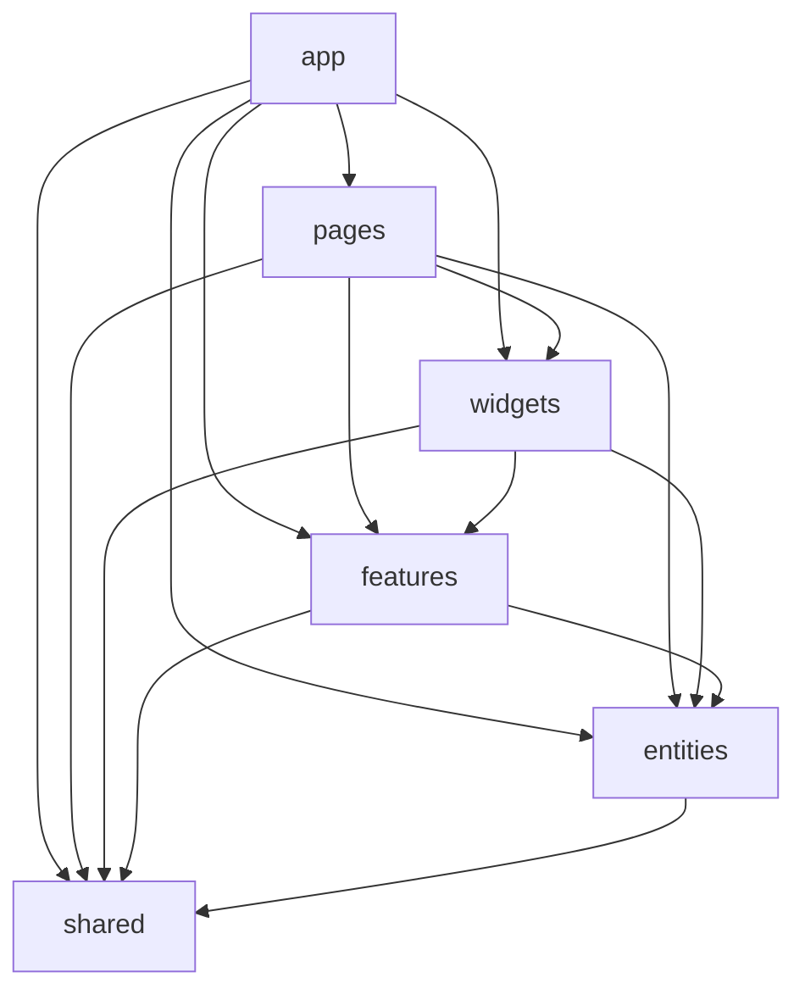

# Vue Lottery App

Односторінковий застосунок для проведення лотереї та керування її учасниками.
Дані користувачів беруться з [DummyJSON](https://dummyjson.com).

**Стек:** Vue 3 (Composition API, `<script setup>`), TypeScript, Vue Router, Pinia,
PrimeVue (тема Aura), VeeValidate + Zod, SCSS, Vite, ESLint, Steiger.

## Запуск

```sh
npm install
npm run dev        # режим розробки
npm run build      # перевірка типів і збірка
npm run lint       # oxlint + ESLint + Steiger (lint:fsd)
npm run lint:fsd   # лише перевірка правил Feature-Sliced Design
```

Адреса API задається у файлі `.env`:

```
VITE_API_URL=https://dummyjson.com
```

## Архітектура: Feature-Sliced Design

```
src/
├── app/        # запуск: main.ts, App.vue, layouts, router + guards, Pinia, PrimeVue, реєстрація сервісів
├── pages/      # home, about, users, user-details, user-create, login, not-found
├── widgets/    # app-header, users-table
├── features/   # auth, user-form, user-delete, pick-winner, theme-toggle
├── entities/   # user (типи, UserService, users store), session (AuthService, session store)
└── shared/     # api (http-client, Repository, ServiceProvider), config, ui (обгортки PrimeVue)
```

Кожен слайс відкриває назовні лише свій Public API (`index.ts`).
Глибокі імпорти та імпорти «вгору» по шарах перевіряють ESLint (`no-restricted-imports`) і Steiger.

### Залежності між шарами

Модуль може імпортувати тільки з шарів, що розташовані нижче.



### Залежності між слайсами

```mermaid
flowchart LR
    subgraph L_PAGES["pages"]
        P_USERS["users"]
        P_DETAILS["user-details"]
        P_CREATE["user-create"]
        P_LOGIN["login"]
    end
    subgraph L_WIDGETS["widgets"]
        W_HEADER["app-header"]
        W_TABLE["users-table"]
    end
    subgraph L_FEATURES["features"]
        F_AUTH["auth"]
        F_FORM["user-form"]
        F_DELETE["user-delete"]
        F_WINNER["pick-winner"]
        F_THEME["theme-toggle"]
    end
    subgraph L_ENTITIES["entities"]
        E_USER["user"]
        E_SESSION["session"]
    end
    subgraph L_SHARED["shared"]
        S_API["api"]
        S_UI["ui"]
        S_CONFIG["config"]
    end

    P_USERS --> W_TABLE
    P_USERS --> F_WINNER
    P_USERS --> E_USER
    P_DETAILS --> F_DELETE
    P_DETAILS --> F_FORM
    P_DETAILS -->