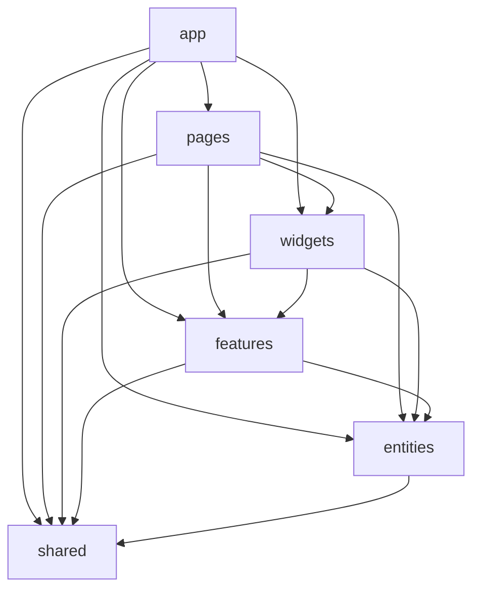
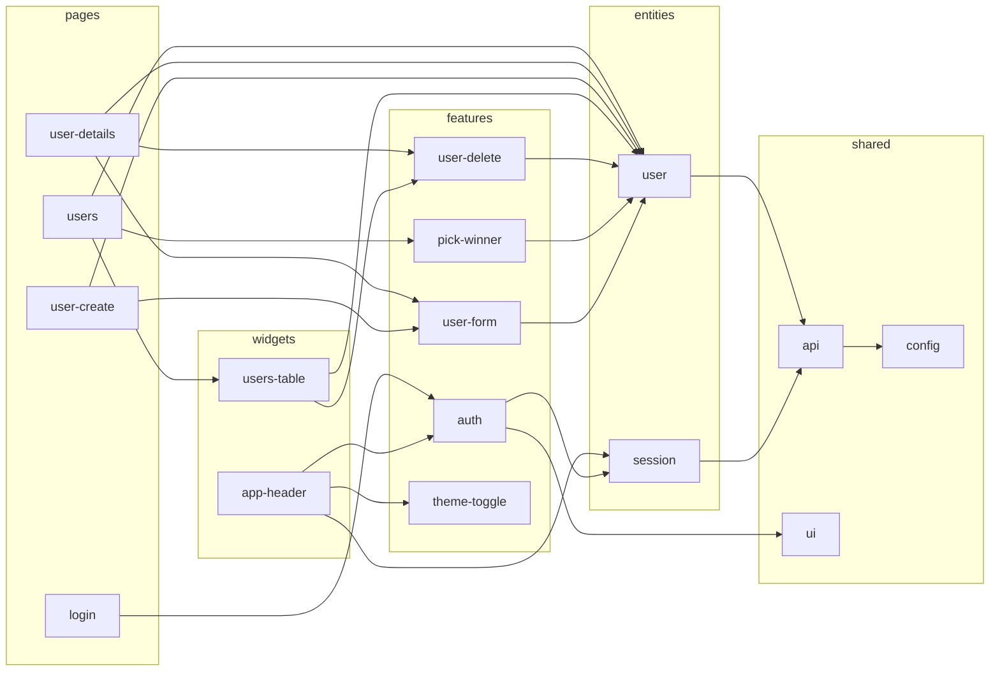

# Vue Lottery App

Односторінковий застосунок для проведення лотереї та керування її учасниками.
Дані користувачів беруться з [DummyJSON](https://dummyjson.com).

**Стек:** Vue 3 (Composition API, `<script setup>`), TypeScript, Vue Router, Pinia,
PrimeVue (тема Aura), VeeValidate + Zod, SCSS, Vite, ESLint, Steiger.

## Запуск

```sh
npm install
npm run dev        # режим розробки
npm run build      # перевірка типів і збірка
npm run lint       # oxlint + ESLint + Steiger (lint:fsd)
npm run lint:fsd   # лише перевірка правил Feature-Sliced Design
```

Адреса API задається у файлі `.env`:

```
VITE_API_URL=https://dummyjson.com
```

## Архітектура: Feature-Sliced Design

```
src/
├── app/        # запуск: main.ts, App.vue, layouts, router + guards, Pinia, PrimeVue, реєстрація сервісів
├── pages/      # home, about, users, user-details, user-create, login, not-found
├── widgets/    # app-header, users-table
├── features/   # auth, user-form, user-delete, pick-winner, theme-toggle
├── entities/   # user (типи, UserService, users store), session (AuthService, session store)
└── shared/     # api (http-client, Repository, ServiceProvider), config, ui (обгортки PrimeVue)
```

Кожен слайс відкриває назовні лише свій Public API (`index.ts`).
Глибокі імпорти та імпорти «вгору» по шарах перевіряють ESLint (`no-restricted-imports`) і Steiger.

### Залежності між шарами

Модуль може імпортувати тільки з шарів, що розташовані нижче.



### Залежності між слайсами



### Repository у FSD

| Частина | Розташування |
| --- | --- |
| HTTP-клієнт, інтерфейси `Readable`, `Creatable`, `Editable`, `Deletable` | `shared/api` |
| `ServiceProvider` (універсальний реєстр сервісів) | `shared/api` |
| `User`, `CreateUserDto`, `UpdateUserDto` | `entities/user/model` |
| `UserService` | `entities/user/api` |
| `AuthService` | `entities/session/api` |
| Реєстрація сервісів у `ServiceProvider` | `app/providers/services.ts` |

## Збереження стану: вручну чи плагіном

У проєкті використано обидва підходи, щоб їх порівняти.

**Вручну — `entities/session/model/session.store.ts`.** Стор сам читає токени з
`localStorage` при створенні і сам записує або видаляє їх у кожній дії
(`setSession`, `setUser`, `clearSession`).

**Плагіном — `features/theme-toggle/model/theme.store.ts`.** Підключено
`pinia-plugin-persistedstate` (`app/providers/pinia.ts`). Стору досить вказати опцію
`persist`, а читання й запис у `localStorage` плагін виконує сам після кожної зміни стану.

| | Вручну (session) | Плагін (theme) |
| --- | --- | --- |
| Обсяг коду | більше: окремі `getItem`/`setItem`/`removeItem` у кожній дії | одна опція `persist` |
| Ризик помилки | легко забути зберегти нове поле | зберігається весь стан (або поля з `pick`) |
| Контроль | повний: окремі ключі, власна логіка очищення, валідація JSON | менше гнучкості, формат запису визначає плагін |
| Коли зберігається | лише у місцях, де ми явно це написали | після будь-якої зміни стану |
| Залежності | немає | додатковий пакет |

Для токенів залишено ручну реалізацію: це чутливі дані, тому краще явно контролювати,
коли саме вони записуються і видаляються. Для простих налаштувань (тема) плагін зручніший.